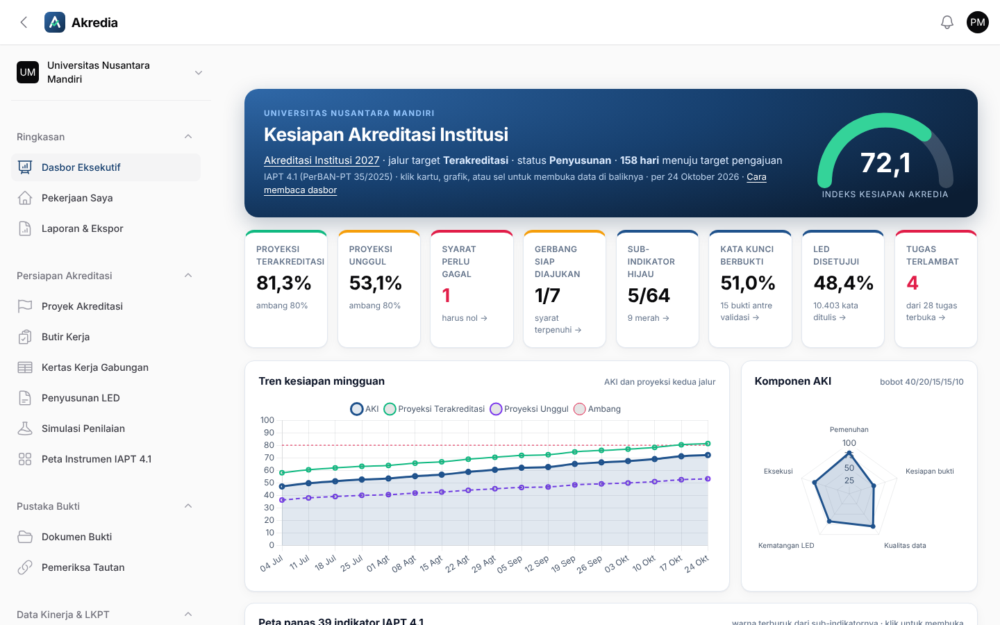
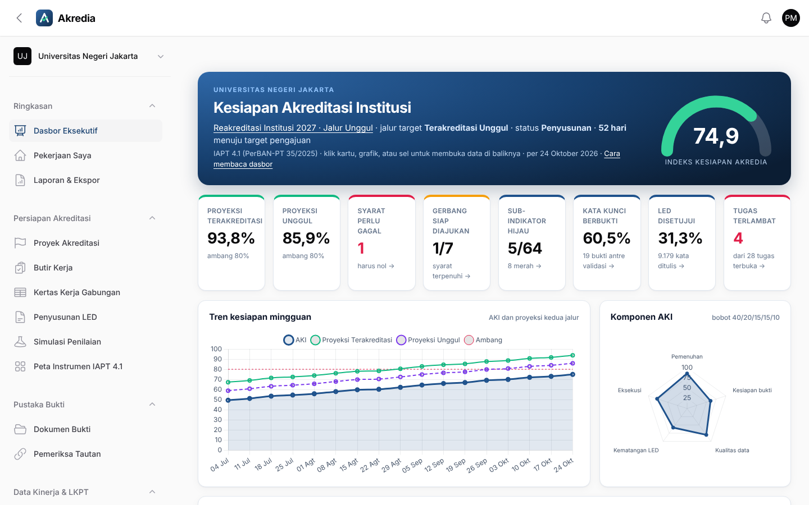
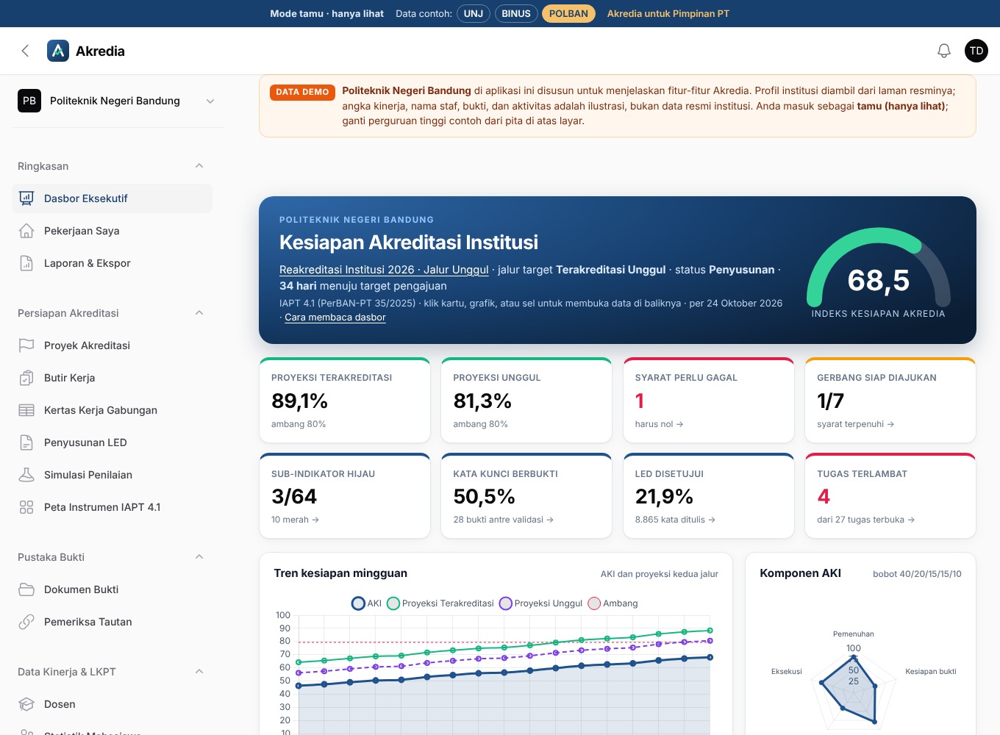
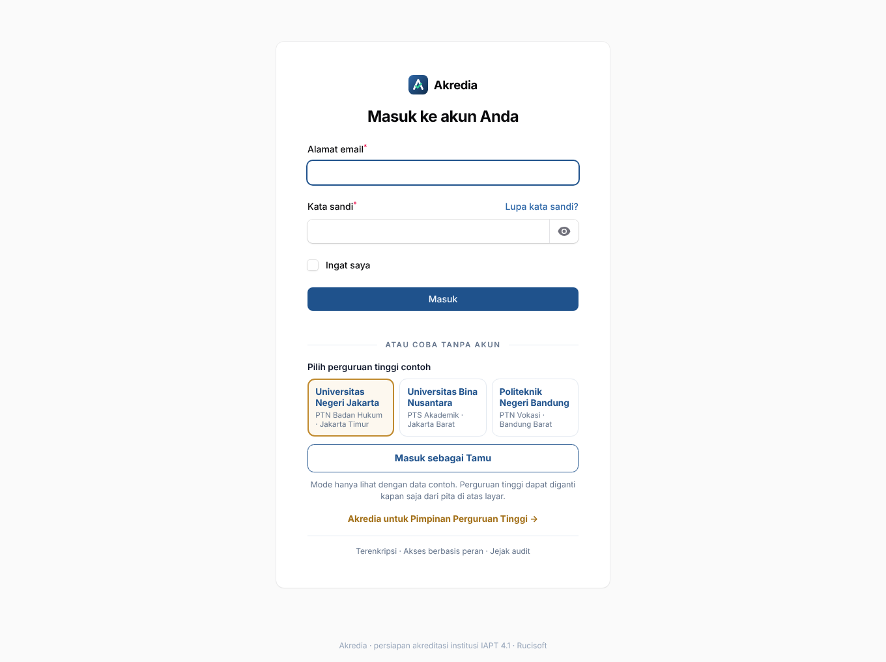
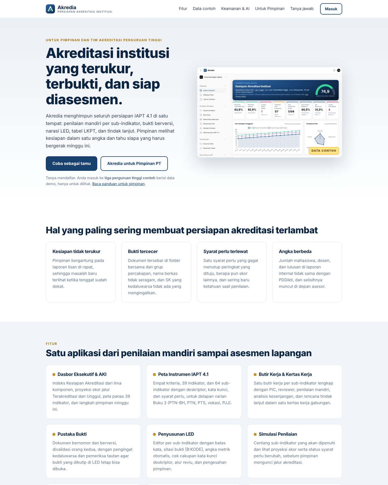

# Akredia

**Akredia** adalah aplikasi web untuk membantu pimpinan dan tim mutu perguruan tinggi menyiapkan **akreditasi institusi** dengan instrumen **IAPT 4.1** (PerBAN-PT Nomor 35 Tahun 2025): 4 kriteria, 39 indikator, 64 sub-indikator per varian, dan 8 varian Buku 3 sesuai jenis perguruan tinggi.

Akredia mengubah pekerjaan akreditasi yang biasanya tersebar di folder, spreadsheet, dan grup percakapan menjadi satu alur yang dapat dipantau: kertas kerja per kata kunci deskriptor, pustaka bukti dengan validasi empat mata, penulisan LED dengan batas kata, perhitungan rasio dari data kinerja, rekonsiliasi dengan PDDikti, simulasi skor, dan dasbor eksekutif untuk rapat pimpinan.

- **Teknologi:** Laravel 13, PHP 8.3, MySQL 8, Filament 5. Tidak membutuhkan Node.js, Redis, atau layanan tambahan, sehingga dapat diunggah ke hosting **cPanel** biasa.
- **Bahasa antarmuka:** Indonesia.
- **Multi-institusi:** satu instalasi dapat melayani beberapa perguruan tinggi; data tiap institusi terisolasi.



## Fitur utama

| Modul | Isi |
|---|---|
| **Dasbor Eksekutif** | Indeks Kesiapan Akreditasi (AKI) dari 5 komponen, tren 16 minggu, proyeksi skor Terakreditasi dan Unggul, peta panas 39 indikator, syarat perlu, status bukti, kematangan LED, rasio terhadap ambang, matriks risiko 5×5, tugas per unit, data mahasiswa, dosen, akreditasi prodi, tracer, survei kepuasan, penelitian & PkM, dan panel *Langkah pimpinan minggu ini* yang disusun otomatis dari data. |
| **Panduan Pimpinan** | Enam halaman penjelasan untuk rektor dan pimpinan: mengenal Akredia, peta jalan 12 bulan, memahami IAPT 4.1, peran pimpinan di tiap tahap, cara membaca dasbor, dan tanya jawab. |
| **Proyek Akreditasi** | Jalur Terakreditasi/Unggul yang dapat dikunci, status proyek, daftar eligibilitas, gerbang *Siap Diajukan*, kunci data TS (freeze), duplikasi proyek. |
| **Butir Kerja & Kertas Kerja** | 64 butir per proyek, PIC dan reviewer (tidak boleh orang yang sama), penilaian mandiri, asesor internal, gap per kata kunci, RTL menjadi tugas, warna hijau/kuning/merah/abu-abu otomatis. |
| **Pustaka Bukti** | Unggah berkas atau tautan, versi, validasi empat mata, kedaluwarsa otomatis, kerahasiaan per unit, pemeriksa tautan rusak, portal bukti publik untuk asesor. |
| **Penyusunan LED** | Editor per sub-indikator dengan penghitung kata, sitasi bukti `[B:BKT/2026/001]`, angka hidup `{{DTJA}}`, cakupan kata kunci, reviu dan pengesahan pimpinan, riwayat revisi, komentar, asisten narasi (lokal, dan AI opsional). Ekspor DOCX dan versi cetak. |
| **Data Kinerja & LKPT** | Dosen, statistik prodi, kohort, prestasi, publikasi, HKI, rekognisi, dana penelitian/PkM, audit keuangan, survei 6 kelompok, tracer study, kepuasan pengguna. 18 metrik IAPT dihitung otomatis; rumus dapat diubah admin. 12 tabel LKPT dan ekspor XLSX. Impor dari XLSX/CSV. |
| **Rekonsiliasi PDDikti** | Bandingkan angka internal dan PDDikti, tingkat keparahan otomatis, alur investigasi sampai terverifikasi. |
| **Simulasi Penilaian** | Analisis *what-if*: centang sub-indikator yang akan dipenuhi dan lihat dampaknya pada proyeksi skor dan syarat perlu. |
| **Pengendalian** | Tugas & RTL, papan Kanban, kalender tenggat, register risiko, keputusan pimpinan yang diturunkan menjadi tugas. |
| **SPMI** | Standar mutu, AMI, temuan, CAPA dengan verifikasi efektivitas oleh orang lain, rapat tinjauan manajemen. |
| **Asesmen Lapangan** | Jadwal sesi, narasumber, bank pertanyaan per kelompok dengan status gladi, rekomendasi asesor yang dapat dijadikan tugas atau CAPA. |
| **Laporan** | LKPT XLSX, kertas kerja XLSX, LED DOCX/cetak, laporan syarat perlu, ringkasan mingguan untuk pimpinan, log audit CSV. |
| **Admin Platform** (`/platform`) | Institusi, pengguna, Pustaka Instrumen (ekspor/impor templat XLSX, ubah deskriptor dan syarat perlu), rumus metrik. |

### Peran pengguna

| Peran | Hak utama |
|---|---|
| Administrator | Semua fitur di institusinya, termasuk pengguna dan konfigurasi. |
| Pimpinan | Melihat semua, mengunci jalur, mengesahkan LED, mencatat keputusan. |
| Manajer Akreditasi | Mengelola proyek, PIC, jadwal, gerbang, kunci data. |
| PIC Indikator | Kertas kerja, LED, dan bukti pada butir yang ditugaskan. |
| Pemilik Data | Bukti dan data kinerja dalam cakupan unitnya. |
| Reviewer | Mereviu bukti dan LED; tidak boleh mereviu karyanya sendiri. |
| Asesor Internal | Penilaian independen dan temuan. |
| Pengamat | Hanya baca. |

## Menjalankan secara lokal

```bash
git clone https://github.com/rucisoft-web/akredia.git
cd akredia
composer install
cp .env.example .env          # sesuaikan DB_*, APP_URL, APP_DEBUG=true, APP_ENV=local
php artisan key:generate
php artisan migrate --seed    # isi AKREDIA_DEMO=true di .env untuk data contoh
php artisan serve
```

Buka `http://localhost:8000/app` untuk aplikasi institusi dan `http://localhost:8000/platform` untuk admin platform.

Untuk instalasi di hosting cPanel (termasuk tanpa Terminal), ikuti [PANDUAN-CPANEL.md](PANDUAN-CPANEL.md).

## Data contoh

Dengan `AKREDIA_DEMO=true`, perintah `php artisan migrate --seed` (atau `php artisan akredia:demo`) memuat tiga perguruan tinggi contoh: **Universitas Negeri Jakarta**, **BINUS University**, dan **Politeknik Negeri Bandung** (lihat di bawah). Profil diambil dari laman resmi masing-masing; angka kinerja dan aktivitas adalah ilustrasi.

Contoh fiktif lama, `php artisan akredia:demo unm`, memuat **Universitas Nusantara Mandiri**, PTS akademik fiktif di Bandung yang sedang menyiapkan *Akreditasi Institusi 2027*: 18 prodi, sekitar 390 dosen, data 8 tahun, 115 dokumen bukti, narasi LED dalam berbagai status, temuan AMI, CAPA, risiko, simulasi visitasi, dan riwayat AKI 16 minggu. Satu syarat perlu (2A) sengaja belum terpenuhi agar alur pengendalian terlihat.

Kata sandi semua akun demo: `Demo#2026akredia` (atau nilai `AKREDIA_DEMO_PASSWORD`).

| Peran | Email |
|---|---|
| Pimpinan (Rektor) | `rektor@akredia.test` |
| Pimpinan (Wakil Rektor I) | `wr1@akredia.test` |
| Manajer Akreditasi (Kepala LPM) | `manajer@akredia.test` |
| Administrator PT | `admin.pt@akredia.test` |
| Reviewer | `reviewer@akredia.test`, `reviewer2@akredia.test` |
| Asesor internal | `asesor@akredia.test` |
| PIC | `pic.lpm@`, `pic.akademik@`, `pic.sdm@`, `pic.keuangan@`, `pic.lppm@`, `pic.kemahasiswaan@`, `pic.sarpras@`, `pic.perencanaan@`, `pic.sekretariat@`, `pic.tik@`, `pic.satgas@akredia.test` |
| Pemilik data | `data.feb@akredia.test` |
| Pengamat (Ketua Yayasan) | `pengamat@akredia.test` |

### Demo Universitas Negeri Jakarta

`php artisan akredia:demo unj` memuat **Universitas Negeri Jakarta** di `/app/unj`: PTN Badan Hukum (PP 31/2024) yang menyiapkan *Reakreditasi Institusi 2027 jalur Unggul* karena SK peringkat Unggul berlaku sampai 2 Februari 2027.

- **Diambil dari unj.ac.id (Oktober 2026):** identitas dan kode PT, status PTN-BH, Rektor dan empat Wakil Rektor, visi-misi, 8 fakultas dan Sekolah Pascasarjana, struktur direktorat, riwayat akreditasi institusi, 59 prodi terakreditasi internasional (ASIIN, AQAS, FIBAA), serta capaian QS/THE yang dijadikan bukti unggulan.
- **Data ilustrasi:** nama pejabat di bawah Wakil Rektor, dosen, angka mahasiswa, publikasi, survei, temuan AMI, risiko, tugas, dan narasi LED. Data ini bukan data resmi UNJ.

Skenario: 91 prodi dengan sekitar 1.190 dosen tetap dan 43 ribu mahasiswa. Satu syarat perlu jalur Unggul (11B, proporsi lektor kepala dan guru besar) sengaja belum terpenuhi. Prodi Gizi dan Bisnis Digital akreditasinya hampir berakhir, dan data mahasiswa aktif masih selisih dengan PDDikti.



| Peran | Email (`@unj.akredia.test`) |
|---|---|
| Rektor | `rektor@` |
| Wakil Rektor I–IV | `wr1@`, `wr2@`, `wr3@`, `wr4@` |
| Kepala SPM / Ketua Tim Reakreditasi | `manajer@` |
| Administrator | `admin.pt@` |
| Reviewer, asesor internal | `reviewer@`, `reviewer2@`, `asesor@` |
| PIC | `pic.lpm@`, `pic.akademik@`, `pic.sdm@`, `pic.keuangan@`, `pic.lppm@`, `pic.kemahasiswaan@`, `pic.sarpras@`, `pic.perencanaan@`, `pic.kerjasama@`, `pic.sekretariat@`, `pic.spi@`, `pic.tik@`, `pic.satgas@` |
| Pengamat (MWA) | `pengamat@` |

### Demo BINUS University

`php artisan akredia:demo binus` memuat **Universitas Bina Nusantara** di `/app/binus`: PTS akademik yang menyiapkan *Reakreditasi Institusi 2027 jalur Unggul* dan sudah hampir siap diajukan (AKI sekitar 81, semua syarat perlu terpenuhi).

- **Diambil dari binus.ac.id (Oktober 2026):** nama, kode PT, badan penyelenggara, Rektor, visi, delapan kampus, sekolah dan fakultas, SK akreditasi institusi Unggul (289/SK/BAN-PT/AK-ISK/PT/VI/2022), ABET untuk Teknik Industri, Teknik Sipil, dan Teknik Komputer, AACSB untuk BINUS Business School, serta QS WUR 2026 (851-900) dan THE WUR 2026 (1201-1500).
- **Data ilustrasi:** nama Wakil Rektor dan pejabat lain, kode dan tanggal akreditasi prodi, dosen, mahasiswa, dan seluruh aktivitas. Akun: `rektor@binus.akredia.test`, `manajer@binus.akredia.test`, dan pola yang sama dengan UNJ.


### Demo Politeknik Negeri Bandung

`php artisan akredia:demo polban` memuat **Politeknik Negeri Bandung** di `/app/polban`: PTN vokasi (IAPT 4.1 varian 3e) yang harus mengunggah reakreditasi dalam sebulan (AKI sekitar 68). Syarat perlu Unggul 4B (proporsi prodi Unggul) belum terpenuhi dan dua prodi D4 segera habis masa akreditasinya.

- **Diambil dari polban.ac.id (Oktober 2026):** nama, alamat, visi, 10 jurusan, 41 program studi (D3, Sarjana Terapan, Magister Terapan), peringkat akreditasi institusi dan prodi yang tercantum, dan capaian UI GreenMetric.
- **Data ilustrasi:** karena masa jabatan Direktur 2022-2026 berakhir Oktober 2026, nama Direktur, Wakil Direktur, dan pejabat dibuat fiktif; kode PT dan prodi, tanggal SK, dan seluruh aktivitas juga ilustrasi. Akun: `direktur@polban.akredia.test`, `wadir1@` s.d. `wadir4@`, `manajer@`, dan seterusnya.



### Masuk sebagai tamu

Halaman login menampilkan pilihan **Masuk sebagai Tamu** dengan kartu tiga perguruan tinggi contoh (UNJ, BINUS, POLBAN). Tamu masuk sebagai Pengamat (hanya lihat): tombol buat, ubah, hapus, dan tindakan pengubah data lain disembunyikan, halaman profil tidak dapat dibuka, dan dapat berganti perguruan tinggi dari pita di atas layar. Setiap halaman institusi contoh menampilkan penanda **DATA DEMO**. Akun tamu bersama `tamu@demo.akredia.test` dibuat oleh `php artisan akredia:demo`; matikan pilihan tamu dengan `AKREDIA_DEMO_GUEST=false`.



### Halaman depan

Alamat `/` kini menampilkan halaman depan publik: masalah yang sering menghambat persiapan, 12 fitur utama, sorotan Simulasi Penilaian, editor LED, dan Rekonsiliasi PD Dikti (bertanda DATA CONTOH), kartu tiga perguruan tinggi contoh dengan tombol **Masuk sebagai tamu** per kampus, keamanan dan AI, pemasangan cPanel, serta tanya jawab. Bila akun tamu belum ada, bagian data contoh disembunyikan dan tombol mengarah ke login. Pengguna yang sudah masuk melihat tombol **Buka aplikasi**.



Halaman pengenalan **Akredia untuk Pimpinan Perguruan Tinggi** tersedia publik di `/untuk-pimpinan` (ditautkan dari halaman login) dan sebagai sub menu pertama grup *Panduan Pimpinan* di aplikasi.

Hapus data contoh kapan saja: `php artisan akredia:remove-demo` (semua) atau `php artisan akredia:remove-demo unm` (satu institusi).

## Perintah artisan

| Perintah | Fungsi |
|---|---|
| `akredia:create-admin` | Buat atau perbarui administrator platform. |
| `akredia:doctor` | Periksa PHP, ekstensi, database, izin folder, aset, dan cron. |
| `akredia:demo [unj\|binus\|polban\|unm\|semua]` / `akredia:remove-demo [slug]` | Muat atau hapus data contoh (`semua` = UNJ, BINUS, POLBAN). |
| `akredia:snapshot` | Hitung ulang AKI dan rekam snapshot harian (terjadwal 01.00). |
| `akredia:reminders` | Pengingat tenggat dan eskalasi tugas terlambat (terjadwal 07.00). |
| `akredia:check-links` | Periksa tautan bukti dan hyperlink LED (terjadwal mingguan). |
| `akredia:weekly-report` | Kirim ringkasan mingguan ke pimpinan (terjadwal Senin 06.30). |

Semua jadwal berjalan dari satu cron per menit (lihat PANDUAN-CPANEL.md langkah 7). Di cPanel, kolom Command diisi `cd /home/USER/akredia && php artisan schedule:run` tanpa bintang jadwal.

## Pengujian

```bash
php artisan test
```

Pengujian mencakup evaluator rumus, prinsip empat mata (PIC/reviewer, pengunggah/validator, pelaksana/verifikator CAPA, penulis/reviewer LED), batas kata LED, gerbang syarat perlu, isolasi data antar-institusi, kerahasiaan dokumen per unit, akses halaman per peran, ekspor, portal publik, dan survei.

## Catatan

AKI dan proyeksi skor adalah alat manajemen internal untuk memantau kesiapan, bukan prediksi resmi nilai BAN-PT. Keputusan akreditasi sepenuhnya kewenangan BAN-PT.

© Rucisoft. Data contoh seluruhnya fiktif.
